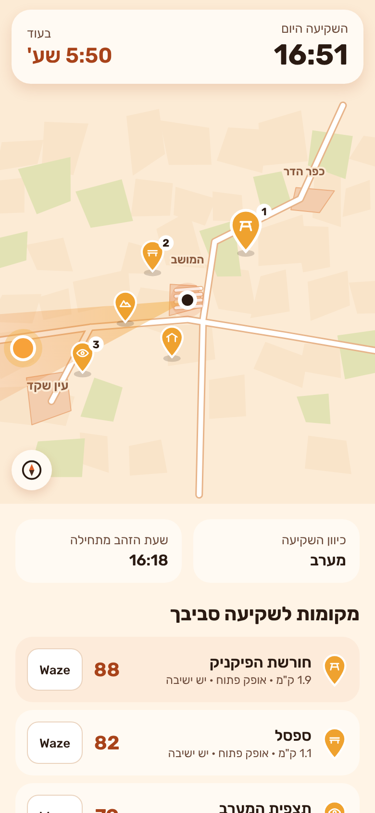
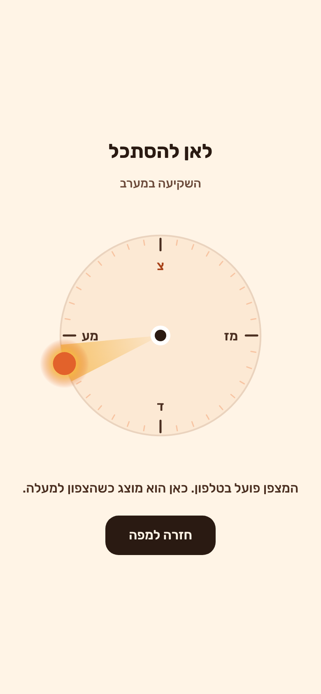

# Spotlight — אפליקציית מקומות שקיעה

ה־Brief המלא ויומן הבנייה: [`project/BRIEF.md`](project/BRIEF.md)

## מה יש כרגע
- **באוויר:** https://orkalifa.github.io/orkalifa/ (בטלפון: "הוסף למסך הבית"). עובד גם אופליין, עם המקומות ואריחי המפה שכבר נצפו
- **מפה** מאריחים וקטוריים של OpenFreeMap (חינם, בלי מפתח): שדות, שטחים ירוקים, מים, כבישים לבנים ושמות בעברית, עם הצפון למעלה ואלומת אור לכיוון השקיעה. המפה מתמקדת אוטומטית כך שכל המקומות נכנסים (עדיין בלי הזזה וזום). לחיצה ארוכה שומרת נקודה
- **HUD שקיעה:** שעת השקיעה, ספירה לאחור, כיוון, ותחזית עננים ("שווה לצאת היום?") מ־Open-Meteo
- **שעת הזהב והשעה הכחולה** בכרטיס אחד
- **מצפן** במסך מלא, שמודיע כשהטלפון מכוון לשקיעה
- **מקומות לשקיעה סביבך** (עד 10 ק"מ) מקובץ ישראל מובנה (נבנה מ־OpenStreetMap ב־`npm run build:spots`), עם דירוג נוף/נגישות/נעימות, כרטיס מקום, Waze ושיתוף בקישור
- **בדיקת קו האופק:** פרופיל גובה לכיוון השקיעה, עם תיקון לעקמומיות ולשבירת האור. אופק חסום מוריד את הציון
- **המקומות שלי** (כפתור הכוכב): מקומות שמורים ו"שקיעות שהיית בהן", רק בטלפון
- אם אין הרשאת מיקום, מוצגת השקיעה בתל אביב, עם "נסה שוב"




## הרצה בטלפון
צריך מחשב עם Node.js 22 ומעלה, והאפליקציה **Expo Go** בטלפון.

```bash
cd apps/sunset-spots
npm install
npx expo start
```

סורקים את קוד ה־QR עם Expo Go (באנדרואיד) או עם המצלמה (באייפון). הטלפון והמחשב צריכים להיות באותה רשת Wi‑Fi.

הפרויקט על **Expo SDK 58**, כמו Expo Go שב־Play Store. אם Expo Go מודיע שהגרסה לא תואמת, צריך להתאים את הפרויקט לגרסה שלו.

גרסת דפדפן: `npx expo start --web`. בדפדפן אין מצפן, אז הוא מוצג כשהצפון למעלה.

## בדיקות
```bash
npm test          # שמש, מקומות, קו אופק וגאומטריית המפה
npm run typecheck
npx expo lint
```

## הערות
- **SunCalc 2.x** מחזירה כיוון במעלות מהצפון, עם כיוון השעון (לא ברדיאנים מהדרום כמו בגרסה 1).
- ציון ה**נוף** מבוסס על קו האופק (70%) ועל סוג המקום ותגית `direction` (30%). אם בדיקת הגובה נכשלת, הציון חוזר להיות מבוסס רק על סוג המקום. ה**נגישות** היא כרגע רק המרחק ממך.
- נתוני הגובה (Copernicus DEM, ~90 מ') לא כוללים בניינים ועצים. לכן מקום בעיר יכול לקבל "אופק פתוח" גם כשבניין חוסם אותו.
- **לפני השקה בחנות:** השימוש החינמי ב־Open-Meteo מיועד לשימוש לא מסחרי. לאפליקציה מסחרית כנראה צריך מנוי, ולכן צריך לבדוק את תנאי השימוש העדכניים.
- הקריאות ל־Overpass ול־Open-Meteo לא נבדקו מול השרתים האמיתיים, כי הרשת של סביבת הפיתוח חסמה אותם. הן נבדקו רק מול תשובות לדוגמה במבנה של שני השירותים.
- **המפה מצוירת ב־SVG** מאריחים וקטוריים של OpenFreeMap. רמת הפירוט נבחרת לפי הטווח (z12 עד z14), והמטמון מוגבל.
