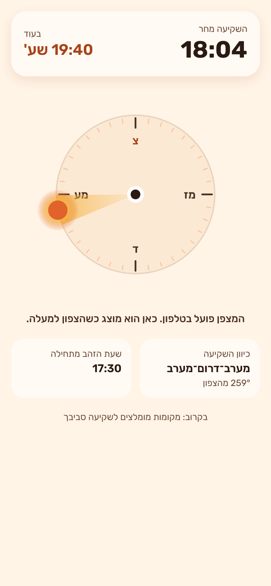

# שקיעה — אפליקציית מקומות שקיעה

ה־Brief המלא: [`ideas/2026-10-18-sunset-spots-app.md`](../../ideas/2026-10-18-sunset-spots-app.md)

## מה יש כרגע (יום 1)
- שעת השקיעה הבאה וספירה לאחור עד אליה, לפי המיקום שלך
- מצפן שמראה לאן השמש שוקעת. בטלפון הוא מסתובב עם המכשיר, ומודיע כשהטלפון מכוון בדיוק לשקיעה
- כיוון השקיעה (16 כיווני מצפן ומעלות) ושעת תחילת שעת הזהב
- אם אין הרשאת מיקום, מוצגת השקיעה בתל אביב



## הרצה בטלפון
צריך מחשב עם Node.js 22 ומעלה, והאפליקציה **Expo Go** בטלפון.

```bash
cd apps/sunset-spots
npm install
npx expo start
```

סורקים את קוד ה־QR עם Expo Go (באנדרואיד) או עם המצלמה (באייפון). הטלפון והמחשב צריכים להיות באותה רשת Wi‑Fi.

גרסת דפדפן: `npx expo start --web`. בדפדפן אין מצפן, אז הוא מוצג כשהצפון למעלה.

## בדיקות
```bash
npm test          # חישובי השמש
npm run typecheck
npx expo lint
```

## הערות
- **SunCalc 2.x** מחזירה כיוון במעלות מהצפון, עם כיוון השעון (לא ברדיאנים מהדרום כמו בגרסה 1).
- המפה של Mapbox תיכנס בהמשך. היא דורשת מפתח Mapbox ו־development build, כי היא לא רצה ב־Expo Go.
